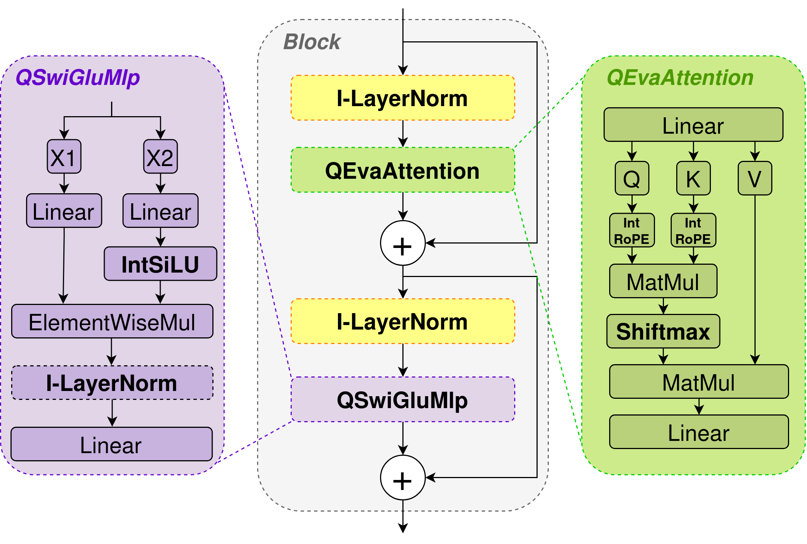

# Integer-Only EVA-02: Sensitivity Analysis and Degradation Localization in Vision Transformers

This is the official PyTorch implementation of the paper:  
**"Integer-Only EVA-02: Sensitivity Analysis and Degradation Localization in Vision Transformers"**  

---

<p align="center">
  
</p>

This repository provides an integer-only quantization and inference framework for the **EVA-02** vision transformer family (Tiny, Small, Base, Large). All operations — including linear layers, 2D RoPE, SwiGLU, SiLU, Softmax, and LayerNorm — are executed entirely using integer arithmetic and bit-shifts without floating-point dequantization.

---

## Model Zoo

| Model | Image Size | Precision | FP32 Top-1 (%) | INT8 Top-1 (%) | Download |
| :--- | :---: | :---: | :---: | :---: | :---: |
| **EVA-02-Tiny** | 336 &times; 336 | W8A8 | 80.62 | 76.92 | [Google Drive](https://drive.google.com/file/d/1VtJTqRh9KAaE5yF48tAi04I0kLvuYnQ_/view?usp=sharing) |
| **EVA-02-Small** | 336 &times; 336 | W8A8 | 85.72 | 83.76 | [Google Drive](https://drive.google.com/file/d/1djdPV_L1d5aXcJ4UaV-eVED_OMW7eO0A/view?usp=sharing) |
| **EVA-02-Base** | 448 &times; 448 | W8A8 | 88.56 | 87.41 | [Google Drive](https://drive.google.com/file/d/1wPCKPm974uMnn-c9zwApmBWc3KUb2nXy/view?usp=sharing) |
| **EVA-02-Large** | 448 &times; 448 | W8A8 | 89.89 | 89.33 | [Google Drive](https://drive.google.com/file/d/1BNzpwQTYiRh14TAtpe1QO9FLBWl2vqVl/view?usp=sharing) |

> **Note on accuracy values:** The results reported in the paper were measured using `torch.compile` on the research FakeQuant simulation pipeline. This repository implements the standalone, pure integer runtime (`int_pytorch`). Minor numerical variations (within decimal fractions of a percent) may occur between the compiled FakeQuant graph and the standalone integer accumulator execution due to differences in rounding and intermediate truncation semantics.

---

## Installation

```bash
git clone https://github.com/sag111/Integer-Only-EVA-02.git
cd Integer-Only-EVA-02
pip install -r requirements.txt
pip install -e .
```

---

## Usage

### 1. Single Image Inference

Run integer inference on a single image with [`inference.py`](inference.py):

```bash
python inference.py \
    -c checkpoints/eva_tiny_int.pt \
    -i path/to/image.jpg
```

**Example output:**
```text
Loading checkpoint: /path/to/checkpoints/eva_tiny_int.pt
Loading image: /path/to/image.jpg
Input: [1, 3, 336, 336], torch.int8
Top-5:
Rank 1: class 91, logit 42
Rank 2: class 15, logit 18
Rank 3: class 320, logit 12
Rank 4: class 218, logit 5
Rank 5: class 77, logit -2
```

---

### 2. Validation on ImageNet-1K

Evaluate integer model accuracy on the ImageNet-1K validation dataset using [`evaluate.py`](evaluate.py):

```bash
python evaluate.py \
    -c checkpoints/eva_tiny_int.pt \
    -v /path/to/imagenet_val \
    --batch_size 32 \
    --device cuda
```

**Quick test on first $N$ samples:**
```bash
python evaluate.py \
    -c checkpoints/eva_tiny_int.pt \
    -v /path/to/imagenet_val \
    --max_samples 100
```

**Example output:**
```text
Loading checkpoint: /path/to/checkpoints/eva_tiny_int.pt
Loading dataset: /path/to/imagenet_val
Evaluating Tiny: ...
Top-1: 76.920%
Top-5: 93.450%
Total: 50000
```

---

## Citation

```bibtex
@article{latalin2026inteva02,
  title   = {Integer-Only EVA-02: Sensitivity Analysis and Degradation Localization in Vision Transformers},
  author  = {Latalin, Vladislav E. and Rybka, Roman B. and Sboev, Alexander G. and Ilyin, Vyacheslav A. and Demin, Vyacheslav A.},
  journal = {IEEE Access},
  year    = {2026}
}
```